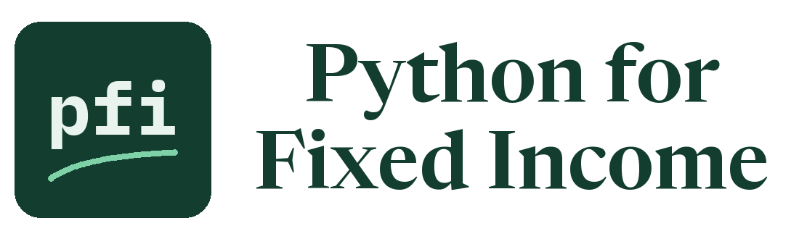
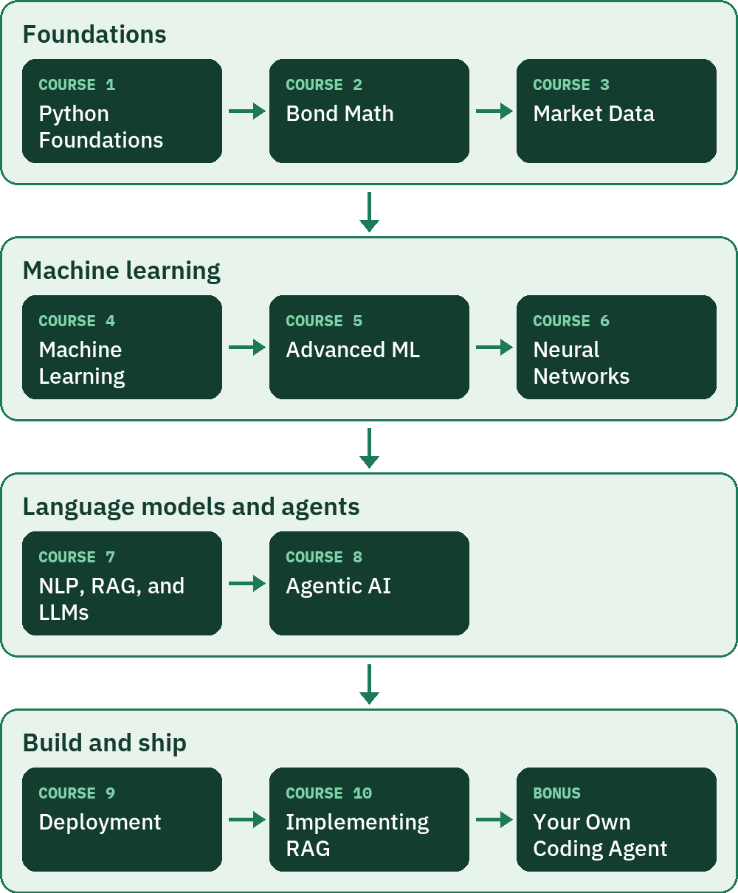
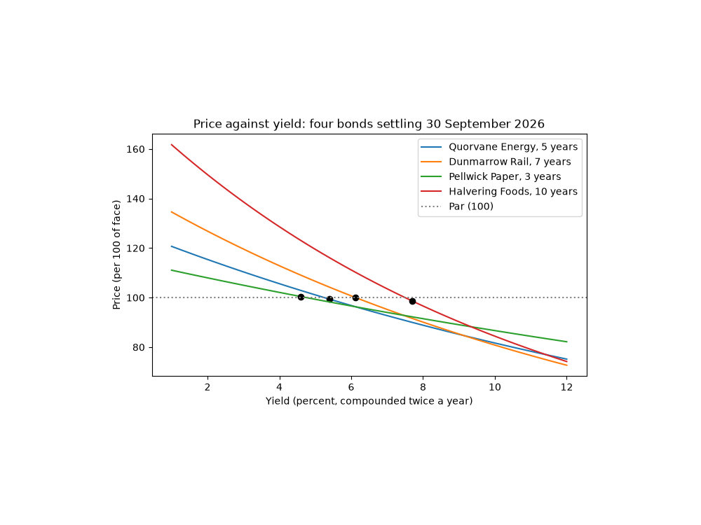
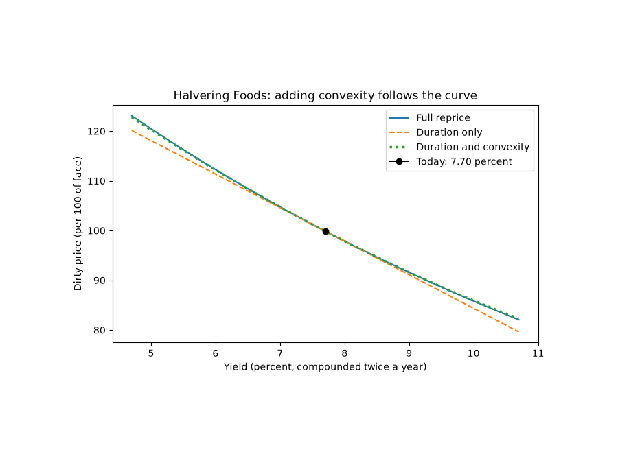
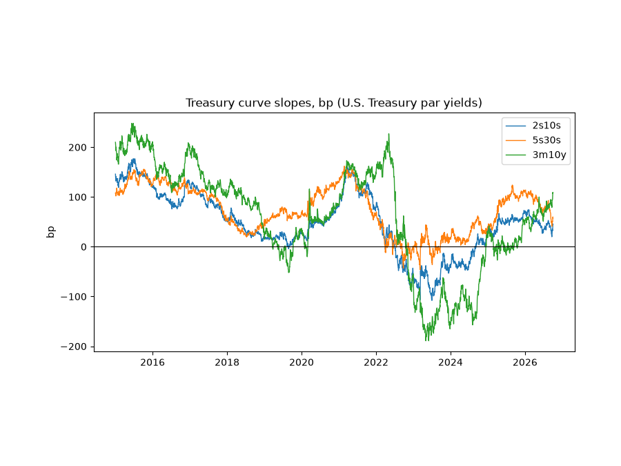
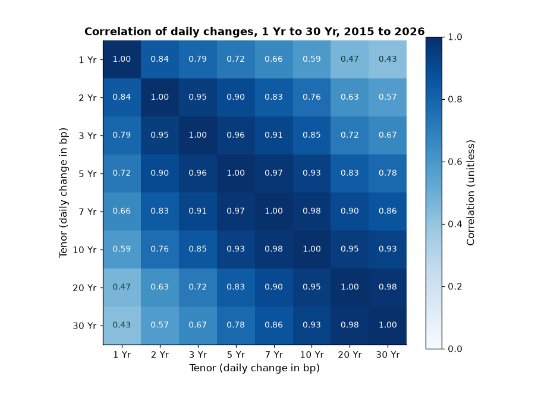
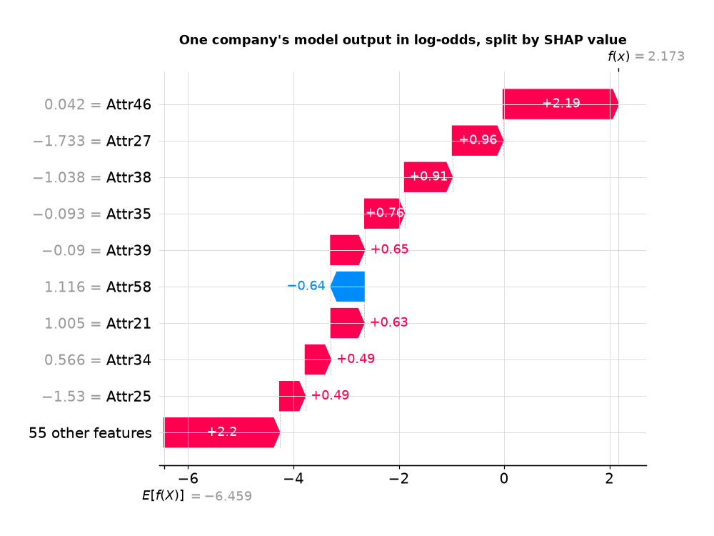
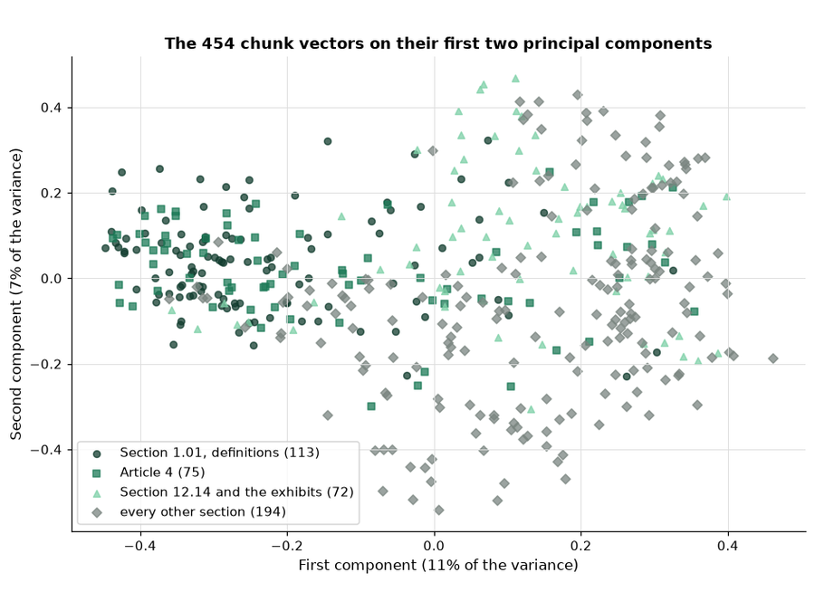

<div align="center">

<picture>
  <source media="(prefers-color-scheme: dark)" srcset="assets/readme/wordmark-dark.png">
  
</picture>

<h3>From your first line of code to your own AI agents.<br>Taught entirely through the work of a credit desk.</h3>

[](#the-courses)
[](#the-courses)
[](#start-here)
[](https://www.python.org/downloads/)
[](#run-in-google-colab-with-nothing-to-install)
[](LICENSE)
[](LICENSE-CONTENT)

**[Start here](#start-here)** &nbsp;·&nbsp; **[The path](#the-path)** &nbsp;·&nbsp; **[What you will build](#what-you-will-build)** &nbsp;·&nbsp; **[Coming from Excel](#if-you-know-excel-you-already-know-how-to-think-about-this)** &nbsp;·&nbsp; **[The courses](#the-courses)** &nbsp;·&nbsp; **[How a day works](#how-a-day-works)**

<br>

<table>
  <tr>
    <td align="center" valign="top" width="25%"><h2>171</h2>notebooks, each with<br>worked solutions</td>
    <td align="center" valign="top" width="25%"><h2>187</h2>Excel comparisons,<br>formula by formula</td>
    <td align="center" valign="top" width="25%"><h2>33</h2>weeks, one notebook<br>a day</td>
    <td align="center" valign="top" width="25%"><h2>$0</h2>to take, and no key<br>needed to run</td>
  </tr>
</table>

</div>

## Python for people who already know bonds

You know what a coupon is. You understand spread, duration, yield, and credit. You live in Excel. You have never written a line of code.

**That is exactly where this series begins.**

Most Python courses teach with shopping carts and movie ratings. This one teaches with the work of a credit desk. Your first variable is a bond's coupon. Your first loop totals a portfolio. Your first table is a holdings file. Your first analysis answers a question you already know how to ask.

And it keeps going. You will price bonds with code you wrote and tested against Excel. You will pull market data from an API, fit machine learning models on credit data, read real indentures with a language model, build a team of AI agents that runs a credit desk's morning brief, and put your work online as an app anyone can open.

> [!NOTE]
> This course is educational content created in a personal capacity. Nothing here is investment advice or a recommendation to buy or sell any security. All portfolio data is synthetic.

## Why this series is different

<table>
  <tr>
    <td width="33%" valign="top">
      <h3>Built on the desk</h3>
      Every example is a fixed income or credit example: holdings files, trade blotters, the Treasury curve, FOMC statements, 10-Ks, and bond indentures.
    </td>
    <td width="33%" valign="top">
      <h3>Excel side by side</h3>
      Every new idea sits beside the Excel formula you would write today, so you are always translating something you already know.
    </td>
    <td width="33%" valign="top">
      <h3>Every number checked</h3>
      You build price, yield, duration, and DV01 yourself and test them against Excel. Every exercise has a check cell that tells you when you are right.
    </td>
  </tr>
  <tr>
    <td width="33%" valign="top">
      <h3>Ready for AI</h3>
      Every day ends with an AI check: code in the style of an AI answer, with one bug for you to find. You learn to use AI and to catch it when it is wrong.
    </td>
    <td width="33%" valign="top">
      <h3>Learn by doing</h3>
      A desk question, a few lines of code that answer it, and one line on what the output shows. Errors are run on purpose and read line by line.
    </td>
    <td width="33%" valign="top">
      <h3>Free, start to finish</h3>
      Every notebook runs in your browser on Google Colab or on your own Windows machine. No paid account and no API key needed to run any of them.
    </td>
  </tr>
</table>

## The path

Eleven courses and a bonus, each one building on the last.

<p align="center">
  <picture>
    <source media="(prefers-color-scheme: dark)" srcset="assets/readme/path-dark.png">
    
  </picture>
</p>

## What you will build

Every course ends with a capstone you can show.

| | Course | Your capstone |
|:---:|:---|:---|
| **1** | [Python Foundations](course1_python_foundations/README.md) | A month-end review of a holdings extract: cleaned, checked against its control totals, compared with its benchmark, and written to Excel |
| **2** | [Bond Math](course2_bond_math/README.md) | Your own bond math module, tested against Excel, and a risk report on a whole book: duration, DV01, convexity, spread, and DTS |
| **3** | [Market Data and Time Series](course3_market_data/README.md) | A daily market snapshot from a vendor extract you test, clean, and reconcile, written to HTML and Excel and run again for another date |
| **4** | [Machine Learning](course4_machine_learning/README.md) | Three models compared on a public file of company statements, each tested on rows it never saw |
| **5** | [Advanced Machine Learning](course5_advanced_ml/README.md) | A logistic regression, a random forest, XGBoost, and LightGBM compared on a public file of company ratios where bankruptcies are rare |
| **5B** | [Time Series Models](course5b_time_series/README.md) | Two series repaired, tested, and modelled walk-forward with ARIMA, smoothing, GARCH, and LightGBM, each measured against carrying the last value forward |
| **6** | [Neural Networks](course6_neural_networks/README.md) | A neural network built in Keras and measured against LightGBM, all on an ordinary laptop CPU |
| **7** | [NLP, RAG, and LLMs](course7_nlp_and_llms/README.md) | A covenant extraction tool, run on an indenture you have never seen, with every number checked against the text |
| **8** | [Implementing Agentic AI](course8_agentic_ai/README.md) | A multi-agent credit desk that writes a morning brief from FOMC statements, an indenture, and the book's risk, with every figure traced to the tool that produced it |
| **9** | [Deployment](course9_deployment/README.md) | The morning brief as a public app: tested on every push, logged, costed, and deployed on free accounts |
| **10** | [Implementing RAG](course10_rag/README.md) | A question-answering tool over public filings that cites the document and page behind every sentence, with its accuracy measured |
| **Bonus** | [Build Your Own Coding Agent](course_bonus_coding_agent/README.md) | A coding agent you write from an empty file, deployed to a private Hugging Face Space with your name on it |

### A look inside

Every result is drawn as a chart or a formatted table. These come straight from the notebooks.

<table>
  <tr>
    <td width="50%" valign="top"><br><sub><b>Course 2</b> · Price and yield</sub></td>
    <td width="50%" valign="top"><br><sub><b>Course 2</b> · Duration and convexity</sub></td>
  </tr>
  <tr>
    <td width="50%" valign="top"><br><sub><b>Course 3</b> · Treasury curve slopes</sub></td>
    <td width="50%" valign="top"><br><sub><b>Course 4</b> · Correlation across the curve</sub></td>
  </tr>
  <tr>
    <td width="50%" valign="top"><br><sub><b>Course 5</b> · A model output, by SHAP value</sub></td>
    <td width="50%" valign="top"><br><sub><b>Course 7</b> · An indenture, as embeddings</sub></td>
  </tr>
</table>

### A taste of day one

> **Q.** QVNE pays 100 of principal in 5 years. Discounted at 5% a year, compounded twice a year, what is that payment worth today?

```python
# ** raises a number to a power: 10 half-year periods at 2.5% each
discount_factor = 1 / (1 + 0.05 / 2) ** 10
# the present value of 100 paid in 5 years
present_value = 100 * discount_factor
print(f'The discount factor is {discount_factor:.6f}')
print(f'100 paid in 5 years is worth {present_value:.2f} today')
```

```
The discount factor is 0.781198
100 paid in 5 years is worth 78.12 today
```

In Excel you would type `=1/(1+0.05/2)^10`. The very next cell shows what happens when you type `^` in Python: it is not a power at all.

## If you know Excel, you already know how to think about this

Nothing here asks you to forget Excel. Wherever Excel has a feature for the job, the new idea is introduced next to it, with the formula written out.

| In Excel you would | In Python you will | Course |
|:---|:---|:---:|
| Fill a formula down a column | Write the formula once, in a loop or on a whole array | 1 |
| Use `VLOOKUP` or `INDEX` and `MATCH` | Merge two tables on a shared column | 1 |
| Build a pivot table | Group by a column and summarize | 1 |
| Goal Seek a yield, or use `RATE` and `YIELD` | Write a loop that solves the yield from a price | 2 |

**[See all 187 comparisons, course by course.](EXCEL.md)**

What changes is what you get to keep. A spreadsheet holds the answer. Code holds the steps that produced it, so the same steps run again on tomorrow's file without anyone dragging a formula or repointing a range.

## Start here

### Run in Google Colab, with nothing to install

> [!TIP]
> The fastest way in. Open the [Course 1 map](course1_python_foundations/README.md#course-map), pick a notebook, and click the **Open in Colab** badge at the top. Colab runs in your browser and needs only a Google account. Every notebook's first cell installs what it needs.

Use Colab on a personal account, with the course data only. Do not upload anything from your employer.

### Run on your own Windows machine

<details>
<summary><b>Three steps: clone, install, open in VS Code</b></summary>

<br>

You need [Python 3.13](https://www.python.org/downloads/), [VS Code](https://code.visualstudio.com/) with the Python and Jupyter extensions, and [git](https://git-scm.com/downloads). On a work machine, check your firm's policy before installing anything.

Two things to get right before Step 1.

| Check | What to do |
|:---|:---|
| **Python on the PATH** | In the Python installer, tick **Add python.exe to PATH** on the first screen. If `python` is still not found later, use `py -3.13` wherever a step says `python`. |
| **Scripts allowed in PowerShell** | Run `Set-ExecutionPolicy -Scope CurrentUser RemoteSigned` once. Without it, Step 2 stops at `Activate.ps1` with a message that running scripts is disabled. |

**Step 1.** Get the course and open its folder.

```powershell
mkdir $HOME\projects -Force
cd $HOME\projects
git clone https://github.com/lenamonj/python-fixed-income.git
cd python-fixed-income
```

No git, or not allowed to install it? On the repo's GitHub page choose **Code**, then **Download ZIP**, unzip it into `projects`, and `cd` into the unzipped folder.

**Step 2.** Create an environment and install everything the series needs.

```powershell
python -m venv .venv
.venv\Scripts\Activate.ps1
python -m pip install -r requirements.txt
```

It is a large install: TensorFlow and PyTorch are in it, so allow time and a few gigabytes of disk. To install one course only, use that course folder's own `requirements.txt` instead.

**Step 3.** Open the folder in VS Code.

```powershell
code .
```

Open `course1_python_foundations\week1\day1\01_python_for_fixed_income_intro.ipynb`, choose the `.venv` kernel in the top right, and run the first cell.

</details>

### Keys and accounts

<details>
<summary><b>No notebook needs a key to run. Here is what you can add, course by course.</b></summary>

<br>

| Course | What you can add |
|:---:|:---|
| 1, 2, 4, 5, 6 | Nothing. Course 2 uses git from its first day. |
| 3 | A free [FRED API key](course3_market_data/README.md#your-fred-key) to pull live data. Without one, every notebook still runs. |
| 7 | A free [OpenRouter key](course7_nlp_and_llms/README.md#your-openrouter-key), or an OpenAI key, for live model requests. Without one, week 3 replays the course's saved responses. |
| 8 | An [OpenAI or OpenRouter key](course8_agentic_ai/README.md#no-key-needed-and-going-live) to run the agents live. Every run is recorded and replays without one. |
| 9 | Free [GitHub, Vercel, and Hugging Face accounts](course9_deployment/README.md#your-accounts) and Docker Desktop to deploy for real. Create the Hugging Face account early: a free account hosts a Space only once it is 30 days old. |
| 10 | A [key of your own](course10_rag/README.md#before-you-start) for live answers. In Colab, the T4 GPU runtime is advised for the local-model cells and never required. |
| Bonus | An [OpenAI key](course_bonus_coding_agent/README.md#start-here) for a live agent, and the Hugging Face account from Course 9 for its private Space. |

Keys live in a `.env` file outside the course repo or in Colab's Secrets panel, never in a notebook or a commit.

</details>

## How a day works

Inside a course, each day has its own folder, and each folder holds three files with the same name.

| | File | What it is |
|:---:|:---|:---|
| **1** | `NN_name_overview.pdf` | A short slide overview of the day's ideas. Read it first. |
| **2** | `NN_name.ipynb` | The notebook. Work through it top to bottom. |
| **3** | `NN_name_solutions.ipynb` | Worked answers to every exercise. Try each one yourself, then check. |

Four habits run through every day.

| Habit | What it means |
|:---|:---|
| **Excel side by side** | Wherever Excel has a function or feature for the job, it is shown next to the Python, formula included. |
| **Errors on purpose** | Code that fails is run for real, and the error is read line by line. |
| **Exercises you can check** | Each exercise has a check cell that tells you whether your number is right. |
| **The AI check** | Each day ends with code written in the style of an AI assistant. It has one bug. You find it by checking the output against a number you worked out yourself. |

> [!IMPORTANT]
> That last habit is the point of the series. You will use AI assistants to write code. Code that runs is not the same as code that is right, and the way to tell the difference is to know what the answer should be.

## The courses

Each course has its own folder, course map, and install list. Weeks start again at 1 in every course. Courses 1 to 10, Course 5B, and the Bonus course are ready. Course 5C is being built, one day at a time.

| Course | Length | What it covers |
|:---:|:---:|:---|
| **1** | 4 weeks | [Python Foundations](course1_python_foundations/README.md): variables, lists, loops, and functions; files and debugging; NumPy and pandas; charts; exploratory data analysis; text; and a project |
| **2** | 3 weeks | [Bond Math](course2_bond_math/README.md): time value of money, price and yield, day counts and accrued interest, duration, DV01, convexity, curve interpolation, spread, and DTS |
| **3** | 3 weeks | [Market Data and Time Series](course3_market_data/README.md): APIs and keys kept secret, market calendars, changes, volatility, z-scores, percentile ranks, slopes, butterflies, and SQL |
| **4** | 3 weeks | [Machine Learning](course4_machine_learning/README.md): regression on the spread cross-section, logistic regression, thresholds, decision trees, walk-forward validation, clustering, and PCA |
| **5** | 3 weeks | [Advanced Machine Learning](course5_advanced_ml/README.md): bagging, random forests, boosting, XGBoost, LightGBM, stacking, honest tuning, rare events, and SHAP values |
| **5B** | 2 weeks | [Time Series Models](course5b_time_series/README.md): missing data and corrections, lags and the naive baselines, stationarity, ACF and PACF, ARIMA, exponential smoothing, GARCH, lag features with LightGBM, and cointegration |
| **5C** | 2 weeks | [Risk Models](course5c_risk_models/README.md), being built one day at a time: Monte Carlo, VaR and expected shortfall, correlated defaults, survival and hazard models, outlier screens, and population stability |
| **6** | 3 weeks | [Neural Networks](course6_neural_networks/README.md): gradients by hand, dense networks in Keras, optimizers, regularization, and sequence models on the Treasury curve |
| **7** | 3 weeks | [NLP, RAG, and LLMs](course7_nlp_and_llms/README.md): TF-IDF, embeddings, semantic search, EDGAR filings, large language models, and covenant extraction from real indentures |
| **8** | 3 weeks | [Implementing Agentic AI](course8_agentic_ai/README.md): the agent loop by hand, tools, MCP, the OpenAI Agents SDK, an orchestrator with specialists, evals, and guardrails |
| **9** | 3 weeks | [Deployment](course9_deployment/README.md): GitHub, pull requests, CI, FastAPI, Vercel, Streamlit, Gradio, Hugging Face Spaces, Docker, and monitoring |
| **10** | 3 weeks | [Implementing RAG](course10_rag/README.md): chunking, embeddings, FAISS, BM25 and hybrid search, reranking, citations, retrieval evaluation, and LLM judges |
| **Bonus** | 1 notebook | [Build Your Own Coding Agent](course_bonus_coding_agent/README.md): a coding agent on OpenAI's Responses API, fenced tools, a chat page, and a private Space |

Every model in the series describes its data. Nothing is a forecast, a rating, or a recommendation, and work on a real filing is descriptive extraction only.

## The data

Every issuer, ticker, CUSIP, price, position, trade, and counterparty in the portfolio files is invented. The courses share one invented portfolio, built to behave like a real one. No real company and no real security appears in any holdings file.

The public files (Treasury yields, FOMC statements, SEC filings, and openly licensed research datasets) keep their values unchanged and their own terms. Licensed market data such as ICE BofA and Moody's series is pulled live with your own FRED key and never stored in the repo.

Every file, its source, its row count, and its terms are on [the data page](data/README.md).

*This product uses the FRED&reg; API but is not endorsed or certified by the Federal Reserve Bank of St. Louis.*

## License

Code is released under the [MIT License](LICENSE). The notebooks' written content, the slide overviews, and the videos are released under [CC BY 4.0](LICENSE-CONTENT): you may share and adapt them, including commercially, as long as you give credit.

The public data files and documents keep their own terms, listed on [the data page](data/README.md). They are not relicensed by this repo. The fonts in `assets/fonts` are under the SIL Open Font License, and their license files sit beside them.

---

<div align="center">

<h3>Ready? Open <a href="course1_python_foundations/README.md">Course 1</a> and run your first cell.</h3>

Created by **Jeff Lenamon**

</div>
