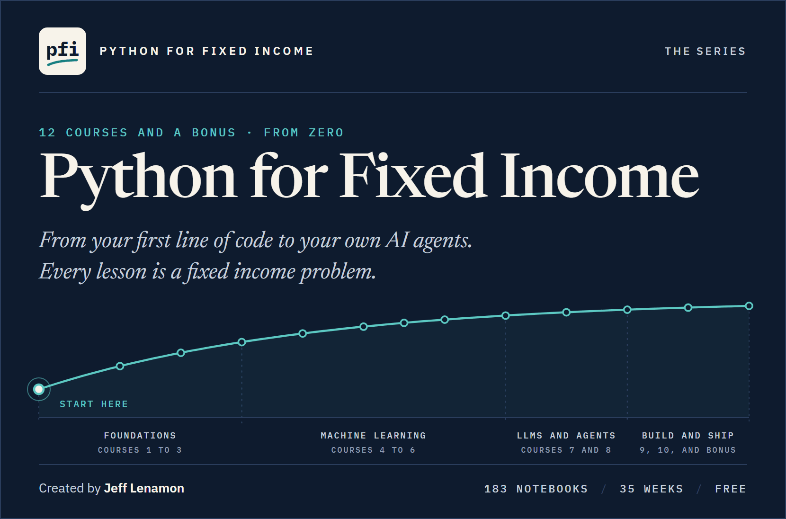
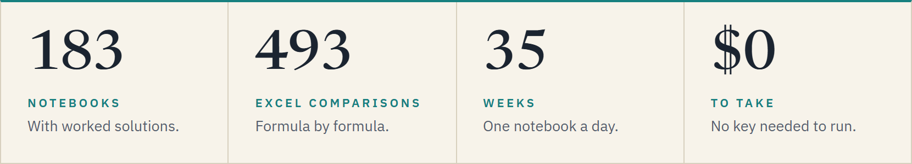
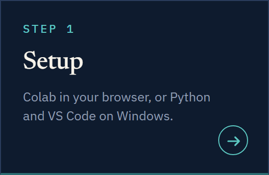
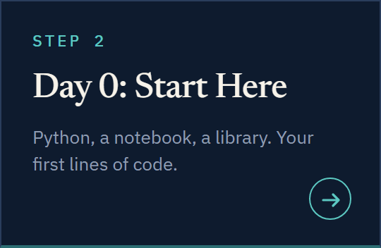
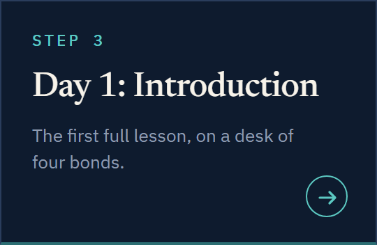
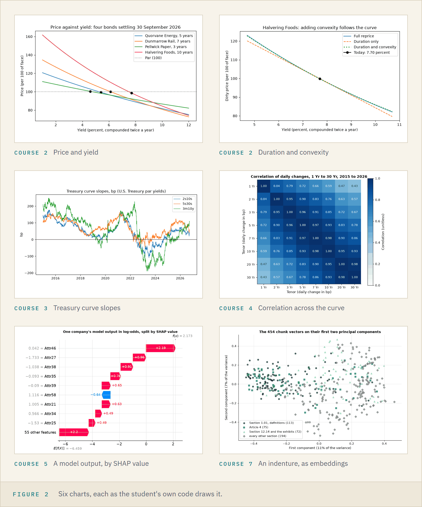
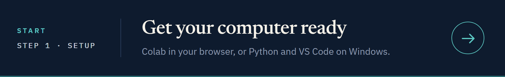

<div align="center">



**[Start here](#start-here)** &nbsp;·&nbsp; **[The courses](#the-courses)** &nbsp;·&nbsp; **[How a day works](#how-a-day-works)** &nbsp;·&nbsp; **[Coming from Excel](#coming-from-excel)**



[](https://www.python.org/downloads/)
[](#run-in-google-colab-with-nothing-to-install)
[](LICENSE)
[](LICENSE-CONTENT)

</div>

## Python for fixed income professionals

Fixed income runs on judgement and on data. The judgement you already have: how a bond is priced, where it sits in the capital structure, what its spread is telling you. This series builds the other half. It teaches you to work with data directly in Python, from your first line of code to models and AI agents that do real work on a credit desk.

It starts at zero. No programming background is assumed, and the [Setup notebook](course01_python_foundations/setup/setup_your_computer.ipynb) walks you through it screen by screen. From there, every lesson is built on the instruments, files, and questions of a fixed income portfolio: coupons and cash flows, holdings extracts and trade blotters, the Treasury curve, FOMC statements, 10-Ks, and bond indentures. Each course ends with a tool you built, tested, and can show.

> [!NOTE]
> This course is educational content created in a personal capacity. Nothing here is investment advice or a recommendation to buy or sell any security. All portfolio data is synthetic.

## Start here

Three notebooks, in this order. If you choose Colab, there is nothing to install.

<p align="center">
<a href="course01_python_foundations/setup/setup_your_computer.ipynb"></a>
<a href="course01_python_foundations/week1/day0/0_start_here.ipynb"></a>
<a href="course01_python_foundations/week1/day1/01_python_for_fixed_income_intro.ipynb"></a>
</p>

[Setup](course01_python_foundations/setup/setup_your_computer.ipynb) has a picture of every step. After Day 1, follow the [Course 1 map](course01_python_foundations/README.md#course-map), one notebook a day.

## The courses

<p align="center">

</p>

| | Course | Weeks | What you build |
|:---:|:---|:---:|:---|
| **1** | [Python Foundations](course01_python_foundations/README.md) | 4 | A month-end review of a holdings extract: cleaned, checked against its control totals, compared with its benchmark, and written to Excel |
| **2** | [Bond Math](course02_bond_math/README.md) | 3 | Your own bond math module, tested against Excel, and a risk report on a whole book: duration, DV01, convexity, spread, and DTS |
| **3** | [Market Data and Time Series](course03_market_data/README.md) | 3 | A daily market snapshot from a vendor extract you test, clean, and reconcile, written to HTML and Excel |
| **4** | [Machine Learning](course04_machine_learning/README.md) | 3 | Three models compared on a public file of company statements, each tested on rows it never saw |
| **5** | [Advanced Machine Learning](course05_advanced_ml/README.md) | 3 | Logistic regression, a random forest, XGBoost, and LightGBM compared on company ratios where bankruptcies are rare |
| **5B** | [Time Series Models](course05b_time_series/README.md) | 2 | Two series modelled walk-forward with ARIMA, smoothing, GARCH, and LightGBM, each measured against carrying the last value forward |
| **5C** | [Risk Models](course05c_risk_models/README.md) | 2 | A risk report on a synthetic book: Monte Carlo credit loss, backtested VaR, a hazard model, a trade screen, and PSI |
| **6** | [Neural Networks](course06_neural_networks/README.md) | 3 | A neural network built in Keras and measured against LightGBM, on an ordinary laptop CPU |
| **7** | [NLP, RAG, and LLMs](course07_nlp_and_llms/README.md) | 3 | A covenant extraction tool, run on an indenture it has never seen, with every number checked against the text |
| **8** | [Implementing Agentic AI](course08_agentic_ai/README.md) | 3 | A multi-agent credit desk that writes a morning brief, with every figure traced to the tool that produced it |
| **9** | [Deployment](course09_deployment/README.md) | 3 | The morning brief as a public app: tested on every push, logged, costed, and deployed on free accounts |
| **10** | [Implementing RAG](course10_rag/README.md) | 3 | A question-answering tool over public filings that cites the document and page behind every sentence |
| **Bonus** | [Build Your Own Coding Agent](course_bonus_coding_agent/README.md) | 1 day | A coding agent written from an empty file, deployed to your own private Hugging Face Space |

### A look inside

<p align="center">

</p>

## How a day works

Each day is one folder with three files of the same name: a short **overview PDF** to read first, the **notebook** to work through top to bottom, and a **solutions notebook** with worked answers.

| Every day has | What it means |
|:---|:---|
| **Desk questions** | Each step starts with a question a colleague would ask, then a few lines of code that answer it. |
| **Excel side by side** | Wherever Excel has a formula or feature for the job, it is shown next to the Python. |
| **Errors on purpose** | Code that fails is run for real, and the error is read line by line. |
| **Checked exercises** | A check cell tells you when your number is right. |
| **The AI check** | The last exercise is code in the style of an AI assistant's answer, with one bug. You find it by knowing what the answer should be. That skill is the point of the series. |

## Coming from Excel

You keep everything you know. The difference is that code keeps the steps, not just the answer, so the same work runs again on tomorrow's file.

| In Excel you would | In Python you will | Course |
|:---|:---|:---:|
| Fill a formula down a column | Write the formula once, in a loop or on a whole array | 1 |
| Use `VLOOKUP` or `INDEX` and `MATCH` | Merge two tables on a shared column | 1 |
| Build a pivot table | Group by a column and summarize | 1 |
| Goal Seek a yield, or use `RATE` and `YIELD` | Write a loop that solves the yield from a price | 2 |

**[All 529 comparisons, course by course](EXCEL.md)**

## Setup details

### Run in Google Colab, with nothing to install

All you need is a Google account. Click the **Open in Colab** badge at the top of any notebook. In Colab, use the course data only, and never upload anything from your employer.

### Run on your own Windows machine

Follow [Setup](course01_python_foundations/setup/setup_your_computer.ipynb), Parts 1 to 4. On a work machine, check your firm's policy before installing anything.

<details>
<summary><b>Already set up with Python 3.13 and VS Code? The short version.</b></summary>

<br>

Tick **Add python.exe to PATH** when you install Python, and run `Set-ExecutionPolicy -Scope CurrentUser RemoteSigned` once so PowerShell can switch the environment on.

```powershell
mkdir $HOME\projects -Force
cd $HOME\projects
git clone https://github.com/lenamonj/python-fixed-income.git
cd python-fixed-income
python -m venv .venv
.venv\Scripts\Activate.ps1
python -m pip install -r requirements.txt
code .
```

No git? Choose **Code**, then **Download ZIP** on this page, and unzip it into `projects`. The full install includes TensorFlow and PyTorch and takes a few gigabytes. For one course only, use that course folder's `requirements.txt`.

</details>

### Keys and accounts

<details>
<summary><b>No notebook needs a key to run. Here is what you can add, course by course.</b></summary>

<br>

| Course | What you can add |
|:---:|:---|
| 1, 2, 4, 5, 5B, 5C, 6 | Nothing. |
| 3 | A free [FRED API key](course03_market_data/README.md#your-fred-key) to pull live data. Without one, every notebook still runs. |
| 7 | A free [OpenRouter key](course07_nlp_and_llms/README.md#your-openrouter-key), or an OpenAI key, for live model requests. Without one, week 3 replays the course's saved responses. |
| 8 | An [OpenAI or OpenRouter key](course08_agentic_ai/README.md#no-key-needed-and-going-live) to run the agents live. Every run is recorded and replays without one. |
| 9 | Free [GitHub, Vercel, and Hugging Face accounts](course09_deployment/README.md#your-accounts) and Docker Desktop to deploy for real. A free Hugging Face account hosts a Space only once it is 30 days old, so create it early. |
| 10 | A [key of your own](course10_rag/README.md#before-you-start) for live answers. Colab's T4 GPU runtime helps the local-model cells and is never required. |
| Bonus | An [OpenAI key](course_bonus_coding_agent/README.md#start-here) for a live agent, and the Hugging Face account from Course 9. |

Keys live in a `.env` file outside the repo or in Colab's Secrets panel, never in a notebook or a commit.

</details>

## The data

Every issuer, ticker, CUSIP, price, position, and trade in the portfolio files is invented. Public files such as Treasury yields, FOMC statements, and SEC filings keep their values and their own terms. Licensed series such as ICE BofA are pulled live with your own FRED key and never stored here. The models describe their data: nothing in the series is a forecast, a rating, or a recommendation. Every file, its source, and its terms are on [the data page](data/README.md).

*This product uses the FRED&reg; API but is not endorsed or certified by the Federal Reserve Bank of St. Louis.*

## License

Code is under the [MIT License](LICENSE). Written content, slide overviews, and videos are under [CC BY 4.0](LICENSE-CONTENT): share and adapt them, including commercially, with credit. Public data files keep their own terms, and the fonts in `assets/fonts` are under the SIL Open Font License.

<p align="center">
<a href="course01_python_foundations/setup/setup_your_computer.ipynb"></a>
</p>

<div align="center">

Created by **Jeff Lenamon**

</div>
