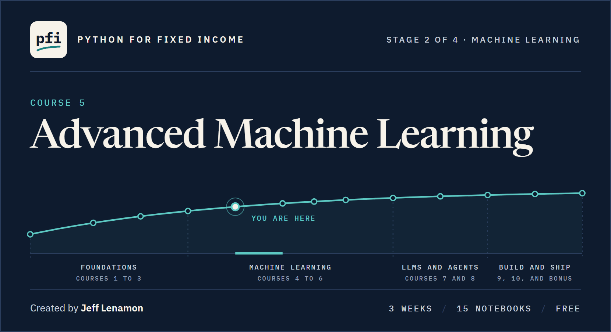

<div align="center">

<a href="../README.md"></a>

[](https://www.python.org/downloads/)
[](../README.md#run-in-google-colab-with-nothing-to-install)
[](../LICENSE)
[](../LICENSE-CONTENT)

**[Before you start](#before-you-start)** &nbsp;·&nbsp; **[The three weeks](#the-three-weeks)** &nbsp;·&nbsp; **[Course map](#course-map)** &nbsp;·&nbsp; **[The capstone](#the-capstone)** &nbsp;·&nbsp; **[What it uses](#what-it-uses)** &nbsp;·&nbsp; **[Course 4](../course04_machine_learning/README.md)** &nbsp;·&nbsp; **[Course 5B](../course05b_time_series/README.md)** &nbsp;·&nbsp; **[Series front page](../README.md)**

## Course 5: Advanced Machine Learning

**Three weeks from one unstable tree to a four-model comparison on a file you have never seen, with every ensemble scored on rows it did not learn from, every tuned number reported honestly, and every contribution described, never read as a cause.**

</div>

On day one you take the card file's training rows from Course 4, draw ten bootstrap samples, fit a tree on each, and measure how far one account's output moves from tree to tree. Three weeks later you fit and read bagging, random forests, AdaBoost, gradient boosting, XGBoost, and LightGBM; rebuild a boosting round by hand and match the library; stack models on out-of-fold outputs; tune with a grid, a randomized search, and an Optuna study and score the search with nested cross-validation; engineer features from financial ratios inside the folds; weigh class weights, resampling, and a threshold for a rare outcome; and split a company's log-odds across its ratios with SHAP values. Then a public file of Taiwanese companies' ratios arrives, and you compare four models on it, choose one on folds of the training rows, open the test rows once, and write what the model shows and where it fails.

**That is the course: ensembles fitted, tuned, and read honestly, on data that is described, never forecast.**

Every model in this course describes a dataset. Nothing in it is a forecast, a rating, or a lending rule. A probability on the card file is a number about that file, never a credit decision about a person; a fitted spread is the model's spread for a bond with those characteristics, never a fair value; an importance says what the model leans on, and a SHAP value is a contribution to one row's log-odds, never a driver or a reason for default.

Each notebook is one problem worked from start to finish: a problem statement, the data, the charts, a model, its score on rows it never saw, and what it shows. Nothing is built outside the notebook. The few functions a day reuses are defined on the page, where you can read every line.

Four habits run through all of it.

| Habit | What it means |
|:---|:---|
| **Closed rows stay closed** | Course 4's splits are rebuilt exactly, and a row Course 4 used as a test row is never scored again. Settings, thresholds, early stopping, stacking, and resampling are all decided inside the training rows, and a search's best score is never reported as the model's own. |
| **Predict, then run** | Four or five times a notebook stops and asks you to write down a number or sketch a chart before the cell that answers it. The answer is never on the page before the question. |
| **The same answer on every run** | One seed, `SEED = 42`, and one thread, written out as `n_jobs=1` on every booster, forest, search, and cross-validation, so a rerun prints the same numbers. |
| **Describe, never forecast** | Every model output, importance, and SHAP value has a plain name, said once, and is never called a driver, a cause, or a reason. Case studies end with where the model fails, not with a recommendation. |

You need Course 4, or the same ground: train, validation, and test rows, `Pipeline` and `ColumnTransformer`, logistic regression and decision trees, cross-validation, ROC AUC and average precision, and the threshold for a recall. This is the fifth course in [Python for Fixed Income](../README.md).

Status: <!-- count:ready -->14<!-- /count --> of <!-- count:total -->14<!-- /count --> notebooks are ready, and so is the capstone.

> This course is educational content created in a personal capacity. Nothing here is investment advice or a recommendation to buy or sell any security. All portfolio data is synthetic.

## Before you start

Setup is on the [series front page](../README.md#start-here). Course 5 runs in the same `.venv` as Courses 1 to 4.

| Step | What to do |
|:---|:---|
| **Install the course's packages** | With the course's `.venv` active, run the install line below. It adds XGBoost, LightGBM, imbalanced-learn, SHAP, and Optuna to Course 4's libraries, and changes none of Course 4's versions. |
| **If `import lightgbm` fails** | If it stops with an `OSError` that names `lib_lightgbm.dll`, Windows is missing a runtime library LightGBM needs and pip does not install: install the Microsoft Visual C++ Redistributable for x64, a free download from Microsoft, and run the line again. The course has not tested this on a machine without that runtime. |
| **No API key** | This course needs no key and no account. Every dataset is in the repo. |
| **Or use Colab** | Open any notebook in the [course map](#course-map) and click the **Open in Colab** badge. Colab's library versions can differ from the pins, so a printed number may differ in its last digits. |

```powershell
Set-Location "$HOME\projects\python-fixed-income"
.venv\Scripts\Activate.ps1
python -m pip install -r course05_advanced_ml\requirements.txt
python -c "import lightgbm; print(lightgbm.__version__)"
```

Each notebook reads its data from the repo's `data` folder, or from GitHub in Colab, and writes no file.

Each day's folder holds three files with the same name: the notebook, a short overview PDF to read first, and a solutions notebook. [How a day works](../README.md#how-a-day-works) explains the pattern. Every notebook in this course follows Course 4's ladder: a problem statement (the business context, the objectives, and the data dictionary), then numbered sections from Setting Up to Insights and Conclusion, then what you can now do and the exercises, with the AI check last: an answer written in the style of an AI assistant that runs and has one bug to find. Every model is shown, not only printed: ten or more charts and pictures on a teaching day, among them bootstrap draws drawn as dots, out-of-bag scores settling as trees are added, importance against a planted column of random numbers, boosting's rounds one by one, early-stopping curves, bootstrap intervals on a gap between two models, a search's sampled points, a SMOTE neighbourhood, and SHAP waterfalls, beeswarms, and dependence plots. Most days have a slider or a dropdown to move, with a still picture under it for where a widget cannot run.

## The three weeks

| Week | Theme | By the end you can |
|:---:|:---|:---|
| 1 | Bagging | Say how much of a tree's output is noise from the rows it happened to see, bag trees and read an out-of-bag score for what it is, fit a random forest and choose its settings out of bag, rank columns by impurity and by permutation with a planted column of random numbers beside them, and fit forests to the spread cross-section in bp |
| 2 | Boosting | Run an AdaBoost round by hand, rebuild gradient boosting from residuals and match the library, brake XGBoost and stop it early on rows carved from the training rows, read LightGBM's trees, stack models on out-of-fold outputs, and say with bootstrap intervals which gaps on the card file are noise |
| 3 | Tuning, rare events, and the capstone | Search settings with a grid, a randomized search, and an Optuna study and score the search with nested cross-validation, engineer features from financial ratios inside the folds, compare class weights, resampling, and a threshold for a rare outcome and recalibrate a moved score, describe a booster with SHAP values, and compare four models on a file you have not seen |

## Course map

<!-- map:start -->

### Week 1: Bagging

| Day | Notebook | You learn | Status |
|:---:|:---|:---|:---:|
| 1 | [Tree Instability and the Bootstrap](week1/day1/01_tree_instability_and_the_bootstrap.ipynb) | Course 4's rows and trees rebuilt, the bootstrap and the share of rows it leaves out, ten trees on ten samples that share a root and split on most accounts, and their average set against every single tree | Ready |
| 2 | [Bagging and Out-of-Bag Scores](week1/day2/02_bagging_and_out_of_bag_scores.ipynb) | Bagging by hand and with scikit-learn, running averages that settle as members join, the out-of-bag score rebuilt and set beside validation, a leaf size chosen without the validation rows, and how alike the members are | Ready |
| 3 | [Random Forests](week1/day3/03_random_forests.ipynb) | Day 2's bag against a forest that draws columns at each split, how far the trees agree, thirty forests mapped by strength and agreement, leaf size against column count chosen out of bag, extra trees, and five models on the validation rows | Ready |
| 4 | [Impurity and Permutation Importance](week1/day4/04_impurity_and_permutation_importance.ipynb) | Planted random numbers against a forest's impurity importance, permutation importance on the validation rows with a noise band, how often each column is split on, grouped shuffles of the six bills, and shuffles on training rows against unseen rows | Ready |
| 5 | [Case Study: Bagging and the Spread Cross-Section](week1/day5/05_case_study_bagging_and_the_spread_cross_section.ipynb) | Case study: Course 4's bonds and spread line against a full tree, bagging, out-of-bag scores and a tuned forest, coupon added, every model scored on issuers it never saw, and where the forest leans and misses | Ready |

### Week 2: Boosting

| Day | Notebook | You learn | Status |
|:---:|:---|:---|:---:|
| 1 | [AdaBoost](week2/day1/06_adaboost.ipynb) | AdaBoost from one stump: a round by hand, the row weights over fifty rounds, 200 stumps scored every round, learning rates and depths on folds, the weighted vote rebuilt, each column's staircase, and the model's output read as a score | Ready |
| 2 | [Gradient Boosting From Residuals](week2/day2/07_gradient_boosting_from_residuals.ipynb) | Gradient boosting on Course 4's bonds: the best single question, one round by hand, the rounds stepping toward each rating's level, rounds against the learning rate, tree depth, and coupon given to every model | Ready |
| 3 | [XGBoost, Regularization, and Early Stopping](week2/day3/08_xgboost_regularization_and_early_stopping.ipynb) | XGBoost on the card file: scores followed tree by tree, early stopping on rows carved from the training rows at two step sizes, a leaf's value and a split's gain rebuilt by hand, lambda and gamma read in them, each brake measured on five folds, the rare class weighted with `scale_pos_weight`, and ten models on one validation set | Ready |
| 4 | [LightGBM and Stacking](week2/day4/09_lightgbm_and_stacking.ipynb) | LightGBM on the card file: its trees read from a table of nodes and drawn leaf by leaf, the split points its bins allow, three settings on five folds, early stopping with a callback, split-count against gain importance, and a stack fitted on out-of-fold outputs by hand and with `StackingClassifier`, beside every blend of three | Ready |
| 5 | [Case Study: Boosting on Credit Card Default](week2/day5/10_case_study_boosting_on_credit_card_default.ipynb) | Eight models on the card file: bootstrap intervals on validation scores and paired intervals on their gaps, a small grid for LightGBM inside the training rows, thresholds read from out-of-fold outputs, Day 9's stack chosen and read for what it leans on, how well its outputs match the default rate, and where it misses | Ready |

### Week 3: Tuning, rare events, and the capstone

| Day | Notebook | You learn | Status |
|:---:|:---|:---|:---:|
| 1 | [Randomized Search and Honest Tuning](week3/day1/11_randomized_search_and_honest_tuning.ipynb) | LightGBM on the Polish file: what a grid costs, nine candidates spent by a grid, by `RandomizedSearchCV` and by an Optuna study, a search's results read fold by fold, how far reshuffling the folds alone moves a score, nested cross-validation, and the threshold chosen after the search | Ready |
| 2 | [Feature Engineering on Financial Ratios](week3/day2/12_feature_engineering_on_financial_ratios.ipynb) | A cap on years written into the benchmark bonds, then the Polish file: ratios built from ratios with their division guarded, gaps as columns against a median fill, four transforms of a long-tailed ratio for the line, clip bounds and quantile maps learned inside each fold, `TargetEncoder` on gap patterns, and each change weighed against the fold noise | Ready |
| 3 | [Resampling, SMOTE, and Class Weights](week3/day3/13_resampling_smote_and_class_weights.ipynb) | The Polish file's rare class: balanced class weights on LightGBM and Course 4's logistic, rows copied, dropped and made up by SMOTE, one SMOTE row built by hand, SMOTE inside the folds against before them, eleven models on the same folds and at one recall, what each fix does to the outputs' sum, and two ways back to a probability | Ready |
| 4 | [SHAP Values](week3/day4/14_shap_values.ipynb) | SHAP values for Day 11's booster on the Polish file: one company's log-odds split into 64 contributions that add up, one contribution turned into probability twice, forty walks, a beeswarm and a dependence plot, SHAP against gain and split counts, a near-copy column dropped, and companies described by fold models that never saw them | Ready |
| 5 | [Course 5 Capstone](week3/day5/course5_capstone.ipynb) | A real file of company ratios checked, described, prepared without a leak, and modelled four ways, tuned on training folds, tested once, and described with SHAP values. A [worked version](week3/day5/course5_capstone_solutions.ipynb) sits beside it | Ready |

<!-- map:end -->

## The capstone

Day 5 of week 3 is yours, and it is more than one sitting: plan on two or three. A colleague who covers Asian corporates hands you a public file of Taiwanese companies' financial ratios, each row flagged by whether the company went bankrupt, and asks which of four models separates the bankrupt rows best on rows it never saw, how sure anyone can be with so few bankrupt rows in the test set, which ratios the chosen model leans on, and where it fails. Nothing is planted in the file: its constant column, its identical column pairs, its columns that hold two scales, its row order, and its rare outcome are the work.

You describe the whole file before any split, drop its constant column and one of each copied pair, and split it once with the test rows closed. You compare a logistic regression, a random forest, XGBoost, and LightGBM on folds of the training rows, tune the leader with a randomized search and score that search with nested cross-validation, decide between class weights, SMOTE, and neither, and read a threshold for a recall of 70 percent from out-of-fold outputs, all before one model is chosen. Then you open the test rows once, put a bootstrap interval on each model's score, describe the chosen model with SHAP values on rows it never fitted, and write what it shows, where it is wrong, and what the data cannot support.

| File | What it is |
|:---|:---|
| [`course5_capstone.ipynb`](week3/day5/course5_capstone.ipynb) | The brief, the questions, and a check line for every answer that can be checked. A check compares a fingerprint of your answer with a stored one, so it says correct or not yet and no answer is on the page |
| [`course5_capstone_overview.pdf`](week3/day5/course5_capstone_overview.pdf) | The brief as slides: the problem, the file, and what each part of the work asks |
| [`course5_capstone_solutions.ipynb`](week3/day5/course5_capstone_solutions.ipynb) | The worked version, with every decision stated. Open it after you finish |

The description you write is about a historical, anonymised dataset. It is not a credit view on any company, and nothing you build is a rating, a credit decision, or a probability of default for any company going forward.

## What it uses

| Tool | Used for | First appears |
|:---|:---|:---|
| scikit-learn | Splits, pipelines, bagging, random forests, extra trees, AdaBoost, gradient boosting, stacking, searches, permutation importance, target encoding, and calibration | Week 1, Day 1 |
| pandas, matplotlib, and seaborn | Tables and charts of every dataset | Week 1, Day 1 |
| ipywidgets | The sliders and dropdowns; it also keeps `import shap` quiet in a notebook | Week 1, Day 1 |
| scipy | The binomial law of out-of-bag counts, and the distributions a randomized search draws from | Week 1, Day 2 |
| plotly | One parallel-coordinates chart you can drag | Week 1, Day 3 |
| XGBoost | Regularised gradient boosting with early stopping | Week 2, Day 3 |
| LightGBM | Leaf-wise gradient boosting, and the model SHAP describes | Week 2, Day 4 |
| Optuna | A guided search beside the grid and the randomized search | Week 3, Day 1 |
| imbalanced-learn | SMOTE, random oversampling and undersampling, inside its own pipeline | Week 3, Day 3 |
| SHAP | Tree SHAP values, and the waterfall, beeswarm, and dependence plots | Week 3, Day 4 |

Exact versions are pinned in [`requirements.txt`](requirements.txt).

| Data | Kind | Used in |
|:---|:---|:---|
| Default of Credit Card Clients: 30,000 accounts in Taiwan in 2005 | Real, public: Yeh, I. (2009). Default of Credit Card Clients [Dataset]. UCI Machine Learning Repository. https://doi.org/10.24432/C55S3H. Licensed under [CC BY 4.0](https://creativecommons.org/licenses/by/4.0/) | Days 1 to 4, 6, and 8 to 10 |
| The benchmark: 821 bonds of 150 issuers, with the rating scale | Synthetic: invented for this series, spreads generated by `tools/make_holdings.py` | Days 5, 7, and 12 |
| Polish Companies Bankruptcy, 5th year: 5,910 financial statements | Real, public: Tomczak, S. (2016). Polish Companies Bankruptcy [Dataset]. UCI Machine Learning Repository. https://doi.org/10.24432/C5F600. Licensed under [CC BY 4.0](https://creativecommons.org/licenses/by/4.0/) | Days 11 to 14 |
| The UCI Taiwanese bankruptcy file: 6,819 rows of company financial ratios, 1999 to 2009 | Real, public: Taiwanese Bankruptcy Prediction [Dataset]. (2020). UCI Machine Learning Repository. https://doi.org/10.24432/C5004D. Licensed under [CC BY 4.0](https://creativecommons.org/licenses/by/4.0/) | The capstone |

Course 5 rebuilds Course 4's splits of the card, benchmark, and Polish files exactly and never scores a row Course 4 used as a test row. The card accounts describe people, so the four columns about them (sex, education, marriage, age) are never model features and no output is grouped by them. Consumer credit in Taiwan in 2005 differs from US credit, and the Polish and Taiwanese companies are each one market and period; every notebook that uses them says so. Sources, terms, and changes for every file are in [the data page](../data/README.md).

## What comes next

[Course 5B is Time Series Models](../course05b_time_series/README.md): two weeks in which two series are modelled walk-forward with ARIMA, smoothing, GARCH, and LightGBM, each measured against carrying the last value forward. [Course 6, Neural Networks](../course06_neural_networks/README.md), follows Course 5B and Course 5C.

---

<div align="center">

Created by **Jeff Lenamon**

</div>
