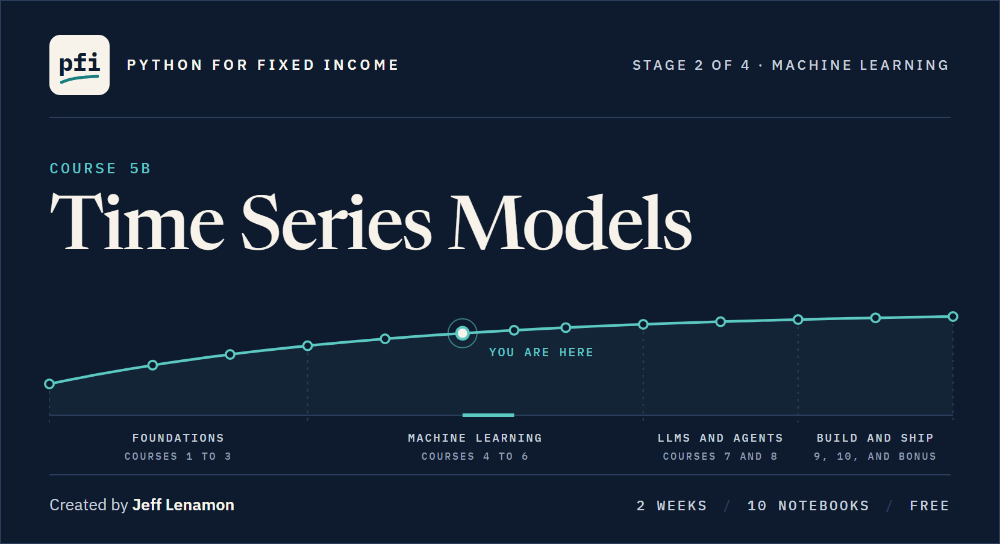

<div align="center">

<a href="../README.md"></a>

[](https://www.python.org/downloads/)
[](../README.md#run-in-google-colab-with-nothing-to-install)
[](../LICENSE)
[](../LICENSE-CONTENT)

**[Before you start](#before-you-start)** &nbsp;·&nbsp; **[The two weeks](#the-two-weeks)** &nbsp;·&nbsp; **[Course map](#course-map)** &nbsp;·&nbsp; **[The capstone](#the-capstone)** &nbsp;·&nbsp; **[What it uses](#what-it-uses)** &nbsp;·&nbsp; **[Course 5](../course05_advanced_ml/README.md)** &nbsp;·&nbsp; **[Course 6](../course06_neural_networks/README.md)** &nbsp;·&nbsp; **[Series front page](../README.md)**

## Course 5B: Time Series Models

**Two weeks from a gap in a dated table to ARIMA, exponential smoothing, GARCH, and gradient boosting on lags, every model scored walk-forward against carrying the last value forward, and every result described, never forecast.**

</div>

On day one you take the U.S. Treasury's daily yield curve, find every gap in it, tell a market holiday from an outage from a tenor that had not started yet, correct wrong values with a change log, and fill gaps on purpose with the method that suits each one. Two weeks later you set a frequency and build lags with no lookahead; test a series for stationarity and difference it; read an ACF and a PACF and pick an order from them; fit AR and ARIMA, exponential smoothing, and GARCH with statsmodels and arch and read every setting; build lag features for LightGBM with no leak; test two series for cointegration and measure a half-life of mean reversion; and say plainly, with numbers, which model beat carrying the last value forward and which did not.

**That is the course: classical time series models, fitted and scored honestly, on data that is described, never forecast.**

Course 3 got dated data, cleaned it, and described it, and fitted no model. Course 5B models a series, so it needs the regression of Course 4 and the boosting of Course 5.

Every model in this course describes the past. A model's output is a fitted change, the model's one-step value for a date inside the file, or a fitted volatility, and it is never a forecast, a projection, or a view on rates. Every value is for a date from 2015-01-02 to 2026-10-02, from a model fitted on earlier dates only. The honest finding of the course, that nothing fitted on past daily changes of the 10 Yr beats carrying the last value forward by more than the folds disagree, while the size of a change is far from random, is taught as the lesson.

Every function goes into a module of your own, `tskit.py`, beside the `mlkit.py` and `ensemblekit.py` you built in Courses 4 and 5. It imports `mlkit` and never changes it, with a test file that grows every day.

Four habits run through all of it.

| Habit | What it means |
|:---|:---|
| **The past only** | Every lag, change, rolling statistic, and fill is checked to use only earlier dates. Models are fitted and scored walk-forward inside the development years, 2015 to 2022, and the held-out years, 2023 to 2026, are opened once, in the capstone. |
| **Excel as the bridge** | Excel has no ADF test, no ARIMA, and no GARCH fitter, and each notebook says so where it applies. Then it shows what Excel can do, with the formula beside the Python: a forward fill as one `IF`, interpolation by hand, a lag as the cell one row up, an autocorrelation as `CORREL` of two offset ranges, AR(1) as `SLOPE` and `INTERCEPT`, EWMA and the GARCH(1,1) variance as one recursive formula each. |
| **The same answer on every run** | One seed, `SEED = 42`, and one thread for the maths libraries, so a rerun prints the same digits, and a run on every core prints them too. |
| **Describe, never forecast** | Every model output has a plain name and a list of names it is never given. Case studies end with "What the model shows, and where it fails" instead of recommendations. |

You need Course 5, or the same ground: walk-forward splits from Course 4, regression, and LightGBM. Each notebook writes the reference `mlkit.py` and the `tskit.py` it starts from into its work folder, so a missing or unfinished module never stops it. Course 5B sits between Course 5 and [Course 6](../course06_neural_networks/README.md), whose sequence networks on the Treasury curve come after it.

Status: <!-- count:ready -->9<!-- /count --> of <!-- count:total -->9<!-- /count --> notebooks and the capstone are ready.

> This course is educational content created in a personal capacity. Nothing here is investment advice or a recommendation to buy or sell any security. All portfolio data is synthetic.

## Before you start

Setup is on the [series front page](../README.md#start-here). Course 5B runs in the same `.venv` as Courses 1 to 5.

| Step | What to do |
|:---|:---|
| **Install the course's packages** | With the course's `.venv` active, run the install line below. It adds `arch`, the GARCH library, to Course 5's pins, and changes none of them. |
| **No API key** | This course needs no key and no account. Every dataset is in the repo. An optional exercise later in the course shows a student with Course 3's FRED key how to run the same workflow on a licensed spread series on their own screen, never saved. |
| **Keep your folder** | Your `my_bondmath` folder, in your `projects` folder beside the course repo, gains `tskit.py` and its tests beside `mlkit.py` and `ensemblekit.py`. If you skipped the earlier courses, create it with the last line below. |
| **Or use Colab** | Open any notebook in the [course map](#course-map) and click the **Open in Colab** badge. Colab's library versions can differ from the pins, so a printed number may differ in its last digits; the setup cell says so when it happens. At the end of each day, download your files from the Colab file browser. |

```powershell
Set-Location "$HOME\projects\python-fixed-income"
.venv\Scripts\Activate.ps1
python -m pip install -r course05b_time_series\requirements.txt
New-Item -ItemType Directory -Force "$HOME\projects\my_bondmath" | Out-Null
```

Each notebook works in a fresh work folder in your temp folder, prints its name, and writes nothing into the course repo. Each day's "Bring It Home" section shows the PowerShell steps that move the day's functions and tests into `my_bondmath`, run the tests, and commit.

Each day's folder holds three files with the same name: the notebook, a short overview PDF to read first, and a solutions notebook. [How a day works](../README.md#how-a-day-works) explains the pattern. As in Courses 2 to 6, every notebook ends in the same order: Excel side by side, save the day with Git, bring it home, then the exercises, with the AI check last. Every section that teaches a method opens with a short "How it works" paragraph, every estimator's settings are read from the installed library into a table, and every lesson is drawn: small multiples with one thing changed per panel, and every comparison as a chart and a formatted table with the best value marked.

## The two weeks

| Week | Theme | By the end you can |
|:---:|:---|:---|
| 1 | A series, its gaps, and its memory | Find, diagnose, correct, and fill every gap in a dated table with a change log; build lags and changes with no lookahead and score the naive baselines walk-forward; test for stationarity and difference; read an ACF and a PACF; and fit AR and ARIMA against the baselines |
| 2 | Beyond ARIMA | Fit exponential smoothing, describe volatility with GARCH and its half-life, build lag features for LightGBM with no leak, test two series for cointegration and measure a half-life of mean reversion, and open the held-out years once in the capstone |

## Course map

<!-- map:start -->

### Week 1: A series, its gaps, and its memory

| Day | Notebook | You learn | Status |
|:---:|:---|:---|:---:|
| 1 | [Missing Data, Gaps, and Corrections](week1/day1/01_missing_data_gaps_and_corrections.ipynb) | Four kinds of missing told apart and counted, the dated rows checked against the market calendar, wrong values found by their shape and by a second source and corrected with a change log, runs of blanks filled four ways and scored against held-back values, and the cut test and `limit=` on a fill | Ready |
| 2 | [Frequency, Lags, and the Naive Baselines](week1/day2/02_frequency_lags_and_the_naive_baselines.ipynb) | Development and held-out years set before a value is seen, lags and changes built by rows and proved with the cut test, the last value carried forward, the training mean and drift as baselines, MAE, RMSE and MASE, the walk-forward loop over five folds, and how far the folds disagree before one rule is called better | Ready |
| 3 | [Stationarity and Differencing](week1/day3/03_stationarity_and_differencing.ipynb) | A trailing mean with a band, AR(1) series built from one set of shocks as phi rises to 1, ADF and KPSS each read against its own null and together in four readings on five series, a regression between two wandering series, and differencing once, twice, and after a log | Ready |
| 4 | [Autocorrelation: ACF and PACF](week1/day4/04_autocorrelation_acf_and_pacf.ipynb) | An autocorrelation by hand and with `acf`, the ACF and its band, what white noise alone puts outside it, changes against their squares, the PACF as a regression coefficient, the identification grid for AR, MA and ARMA, Ljung-Box by hand and with `acorr_ljungbox`, and a lag checked window by window | Ready |
| 5 | [Case Study: AR and ARIMA on the Curve](week1/day5/05_case_study_ar_and_arima_on_the_curve.ipynb) | An AR(1) fitted by hand and with `ARIMA`, one-step values with `.append()`, MA and ARIMA and one shock traced through each, AIC and BIC over p and q, the roots on the unit circle, residual diagnostics, and every order scored walk-forward on five folds against the last value | Ready |

### Week 2: Beyond ARIMA

| Day | Notebook | You learn | Status |
|:---:|:---|:---|:---:|
| 1 | [Exponential Smoothing](week2/day1/06_exponential_smoothing.ipynb) | The EWMA by hand and as a weighted average, alpha chosen on training misses, simple, Holt and damped smoothing with every setting of `ExponentialSmoothing`, five series scored walk-forward against the last value, and an EWMA of the size of a change with RiskMetrics beside it | Ready |
| 2 | [Volatility Clustering and GARCH](week2/day2/07_volatility_clustering_and_garch.ipynb) | Where the largest days fall, the GARCH(1,1) recursion with a slider, half-lives of persistence, GARCH fitted on five series with arch, three volatilities through 2020, normal against Student's t and seven variance models by BIC, the news-impact curve, and the size of a change scored walk-forward | Ready |
| 3 | [Lag Features and Gradient Boosting](week2/day3/08_lag_features_and_gradient_boosting.ipynb) | Fifteen lag features built from past rows only and passed through the cut test, a weekday and correlation read, LightGBM on lags walked over five folds, one leaky column caught, four settings swept with early stopping, every rule scored by MASE on five series, shuffled importance against five noise columns, and the size with partial dependence | Ready |
| 4 | [Two Series: Cointegration and Mean Reversion](week2/day4/09_two_series_cointegration_and_mean_reversion.ipynb) | Two pairs drawn together, a hedge ratio by eye with a slider and by least squares, the gap and its bands, a map of each pair's past 20-row moves, the Engle-Granger test on each pair's gap, the half-life of a gap beside random walks, and the hedge ratio rolled through the years and tested on each fold | Ready |
| 5 | [Course 5B Capstone](week2/day5/course5b_capstone.ipynb) | The course's workflow on the 2s10s and the synthetic HY spread: a planted copy repaired with a log, stationarity and memory, Day 2's folds and bar, ARIMA, smoothing and LightGBM on lags, GARCH for the size, four choices by Day 2's rule, and the held-out years opened once on three refitted blocks | Ready |

<!-- map:end -->

## The capstone

Day 5 of week 2 is yours. You run the course's workflow on two series, 2s10s and the synthetic high yield spread: repair the planted gaps with a change log, set the development and held-out years, test stationarity, read the ACF and PACF, fit the baselines, ARIMA, exponential smoothing, and LightGBM on lags walk-forward on the development years, describe volatility with GARCH, choose on development, open the held-out years once, and write "What the models show, and where they fail". A worked version sits beside it.

## What it uses

| Tool | Used for | First appears |
|:---|:---|:---|
| pandas | Dated tables, gaps, corrections, fills, lags, and changes | Week 1, Day 1 |
| statsmodels | ADF and KPSS tests, ACF and PACF, ARIMA, exponential smoothing, Ljung-Box, and cointegration | Week 1, Day 3 |
| arch | GARCH volatility models | Week 2, Day 2 |
| LightGBM | Gradient boosting on lag features | Week 2, Day 3 |
| pytest and Git | Testing `tskit.py` every day, and keeping the change log and each model's results beside the code | Week 1, Day 1 |
| matplotlib and `plotkit.py` | Every chart, and formatted comparison tables with pandas' Styler; `plotkit.py` is Course 4's helper file, written unchanged into every work folder | Week 1, Day 1 |
| scikit-learn and scipy | Metrics and Course 4's `mlkit.py`, which imports them | Week 1, Day 1 |
| XGBoost, CatBoost, Optuna, imbalanced-learn, SHAP, ipywidgets | Not used; kept from Course 5's pins so one environment runs Courses 4 to 6 | |

Exact versions are pinned in [`requirements.txt`](requirements.txt): `arch` 8.0.0 on top of Course 5's pins, among them numpy 2.5.3, pandas 3.0.6, statsmodels 0.15.0, scikit-learn 1.9.1, LightGBM 4.7.0, and pytest 9.1.1. Git is installed separately (see [Course 2](../course02_bond_math/README.md#before-you-start)).

| Data | Kind | Used in |
|:---|:---|:---|
| Daily Treasury par yield curve rates, 2015-01-02 to 2026-10-02 | Real, public: U.S. Department of the Treasury, public domain | Every day |
| 2,940 daily investment grade and high yield spreads in bp | Synthetic: invented for Course 3, not ICE, Moody's, or any index | Days 3, 4, 6, and 9, and the capstone |

Day 1's gaps, outage, and wrong values are planted in a copy of the Treasury file by a seeded generator inside the notebook, and the notebook says so; the published file is kept aside to check every repair against. Course 5B adds no data file. Sources and terms for every file are in [the data page](../data/README.md).

## What comes next

[Course 6 is Neural Networks](../course06_neural_networks/README.md): three weeks from one neuron worked out by hand to dense, recurrent, and convolutional networks, ending with sequence models on the same Treasury curve, scored walk-forward against the same last value carried forward.

---

<div align="center">

Created by **Jeff Lenamon**

</div>
