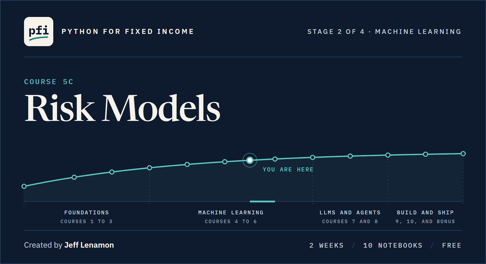

<div align="center">

<a href="../README.md"></a>

[](https://www.python.org/downloads/)
[](../README.md#run-in-google-colab-with-nothing-to-install)
[](../LICENSE)
[](../LICENSE-CONTENT)

**[Before you start](#before-you-start)** &nbsp;&middot;&nbsp; **[The two weeks](#the-two-weeks)** &nbsp;&middot;&nbsp; **[Course map](#course-map)** &nbsp;&middot;&nbsp; **[The capstone](#the-capstone)** &nbsp;&middot;&nbsp; **[What it uses](#what-it-uses)** &nbsp;&middot;&nbsp; **[Course 5B](../course05b_time_series/README.md)** &nbsp;&middot;&nbsp; **[Course 6](../course06_neural_networks/README.md)** &nbsp;&middot;&nbsp; **[Series front page](../README.md)**

## Course 5C: Risk Models

**Two weeks of the models a risk desk runs: Monte Carlo and VaR, correlated defaults, survival and hazard models, screens for unusual data, and the population stability index, every one on synthetic or public data and every result described, never forecast.**

</div>

On day one you simulate one bond's credit loss year by year, set it beside PD x LGD x EAD, and put a standard error on every simulated mean.
Two weeks later you replay 2,000 past days on the course's synthetic book and read its VaR and expected shortfall, then backtest a rolling VaR with the cut test and Kupiec's test; simulate correlated defaults through one common factor and check the tail against the Vasicek formula; follow 4,000 invented firms with Kaplan-Meier, the log-rank test, a Cox model, and a discrete-time hazard scored walk-forward by study year; screen trades and bonds with robust rules, the Mahalanobis distance, isolation forest, and local outlier factor, scored against planted labels; measure drift with PSI on bins fixed before the compared rows are read; and watch a frozen credit model year by year with a monitoring report whose bands are stated.
Then the capstone asks for one risk report on the book and the cohort: every choice made on the development rows by a rule written first, and the held-out years opened once.

**That is the course: risk models built, checked against what is known, and read for what they say and what they cannot.**

Every loss in this course is a conditional statement: had these past days repeated on the book held fixed, or under these invented inputs.
A VaR is a percentile of those losses and an expected shortfall their average beyond it, never what the book will lose.
Default rates are counted from a synthetic cohort of invented firms, never taken from an agency study or a real issuer.
A hazard ratio describes an association in that file, never a cause.
A flagged trade is a print to check, never a mispriced bond, and PSI says how far a mix moved, never where it goes next.

Each notebook is one problem worked from start to finish: a problem statement, the data, the charts, the models, their scores, and what they show.
Nothing is built outside the notebook.
The few functions a day reuses are defined on the page, where you can read every line.

Five habits run through all of it.

| Habit | What it means |
|:---|:---|
| **Check against a known answer** | A simulation is first run where an exact answer exists (PD x LGD x EAD, the binomial, the Vasicek formula), and a model on a cohort whose planted coefficients are written down, so you can see it recover them. Every screen is scored on bad values planted in a copy, with the labels kept for scoring only. |
| **The past only** | The curve and spreads are cut at 2022-12-30, and the cohort at study year 14, before a value is read. Every VaR, model, threshold, and bin edge is set on the development rows, and the held-out rows are opened once, in the capstone. A rolling VaR and every feature a model reads pass the cut test. |
| **Predict, then run** | Four to six times a notebook stops and asks you to write down a number or sketch a chart before the cell that answers it. The answer is never on the page before the question. |
| **The same answer on every run** | One seed, `SEED = 42`, one generator for every experiment and `spawn` for independent streams, one thread for the maths libraries, and a fixed `random_state` or `n_jobs=1` on every scikit-learn estimator that takes one, so a rerun prints the same digits. |
| **Describe, never forecast** | Every output has a plain name, said once: simulated loss, VaR, fitted hazard, flag, score. Case studies end with what the models show and where they fail, not with a recommendation. |

You need Course 5B, or the same ground: Course 2's duration and DTS, Course 4's logistic regression, ROC AUC, calibration, and walk-forward folds, and Course 5B's development and held-out years and the cut test.
Course 5C sits between Course 5B and [Course 6](../course06_neural_networks/README.md) in [Python for Fixed Income](../README.md).

Status: <!-- count:ready -->10<!-- /count --> of <!-- count:total -->10<!-- /count --> notebooks are ready.

> This course is educational content created in a personal capacity. Nothing here is investment advice or a recommendation to buy or sell any security. All portfolio data is synthetic.

## Before you start

Setup is on the [series front page](../README.md#start-here).
Course 5C runs in the same `.venv` as Courses 1 to 5B.

| Step | What to do |
|:---|:---|
| **Install the course's packages** | With the course's `.venv` active, run the install line below. Course 5C adds no library: statsmodels fits the survival and hazard models, and scikit-learn the screens. |
| **No API key** | This course needs no key and no account. Every dataset is in the repo. |
| **Or use Colab** | Open any notebook in the [course map](#course-map) and click the **Open in Colab** badge. Colab's library versions can differ from the pins, so a printed number may differ in its last digits. |

```powershell
Set-Location "$HOME\projects\python-fixed-income"
.venv\Scripts\Activate.ps1
python -m pip install -r course05c_risk_models\requirements.txt
```

Each notebook reads its data from the repo's `data` folder, or from GitHub in Colab, and writes no file.

Each day's folder holds three files with the same name: the notebook, a short overview PDF to read first, and a solutions notebook.
[How a day works](../README.md#how-a-day-works) explains the pattern.
Every notebook in this course follows Course 4's ladder: a problem statement (the business context, the objectives, and the data dictionary), then numbered sections from Setting Up to Insights and Conclusion, then what you can now do and the exercises, with the AI check last: an answer written in the style of an AI assistant that runs and has one bug to find.
Every model is shown, not only printed: ten or more charts and pictures on a teaching day, among them antithetic pairs joined as mirror arcs, an iso-loss scatter, a mean excess plot, a Lexis diagram, a survival curve with its number-at-risk table, a volcano plot, log-minus-log curves, breakdown curves, robust tolerance ellipses, P-P plots on a decile grid, a shift function, a count ladder, and an alluvial.
Every teaching day has a slider to move, with a still picture under it for where a widget cannot run.

## The two weeks

| Week | Theme | By the end you can |
|:---:|:---|:---|
| 1 | Simulation and default | Run a seeded Monte Carlo and state its error; replay past days on the book and read VaR and expected shortfall, then backtest a rolling VaR; simulate correlated defaults and read the book's loss tail against the Vasicek formula; estimate survival curves with censoring; and fit Cox and discrete-time hazard models and score them walk-forward by study year |
| 2 | Unusual data and drift | Screen trades, curve days, and bonds with robust rules, the Mahalanobis distance, isolation forest, and local outlier factor, scored on planted labels; measure drift with PSI beside the KS test and Jensen-Shannon; monitor a frozen credit model year by year with stated bands; and open the held-out years once in the capstone |

Days are numbered through the course: Day 6 is week 2's first day, and the capstone is week 2's fifth.

## Course map

<!-- map:start -->

### Week 1: Simulation and default

| Day | Notebook | You learn | Status |
|:---:|:---|:---|:---:|
| 1 | [Monte Carlo Foundations](week1/day1/01_monte_carlo_foundations.ipynb) | One bond's credit loss simulated year by year against PD x LGD x EAD, a standard error on every simulated mean and twenty runs closing in, seeds and spawned streams, the inverse transform and normal, Student's t, lognormal, and beta draws with their tails compared, defaults among 50 bonds against the binomial, antithetic pairs on two payoffs, the trials a stated precision needs, and a check of how often the 95 percent interval holds | Ready |
| 2 | [Historical Simulation and VaR](week1/day2/02_historical_simulation_and_var.ipynb) | The book's rate exposure split across eight tenors with hat weights and its spread exposure by DTS, 2,000 past days replayed on the book held fixed, VaR and expected shortfall from the history, an iso-loss scatter of the rate and spread parts, a mean excess plot, a normal model and a fitted Student's t beside the history, a rolling 500-day VaR backtested with the cut test and Kupiec's test, the window and level changed and compared on the same days, and a one-day VaR stretched to ten days three ways | Ready |
| 3 | [Correlated Defaults and the Loss Distribution](week1/day3/03_correlated_defaults_and_the_loss_distribution.ipynb) | Default rates counted per firm-year from the synthetic cohort and bounded where none was counted, one pooled logistic fit giving every bond a default probability, yearly default counts set against the band independence allows, the one-factor model with its correlation swept, the Vasicek formula checked against a simulation, the book's credit loss with VaR and expected shortfall read to their precision across spawned runs and its tail split by rating, and two factors correlated with a Cholesky factor beside a matrix that has none | Ready |
| 4 | [Survival Curves and Kaplan-Meier](week1/day4/04_survival_curves_and_kaplan_meier.ipynb) | Firm-years turned into one row per firm with a time and an event, every watch drawn on a Lexis diagram, Kaplan-Meier worked by hand on ten firms and as a short function, the curve set beside two shortcuts that drop censored firms or count them as survivors with a number-at-risk table beneath, the same curve fitted in statsmodels with Greenwood's band, curves by rating at entry compared by the log-rank test, the hazard year by year with its cumulative sum and a flat hazard's curve, and the credit triangle turning an invented spread and recovery into a hazard | Ready |
| 5 | [Case Study: Hazard Models](week1/day5/05_case_study_hazard_models.ipynb) | Firm-years read as intervals on the years-since-entry clock and the counted hazard mapped on a Lexis surface, a Cox partial likelihood worked by hand on ten firms and matched in statsmodels with its entry, ties, and strata set, hazard ratios read for rating, leverage, and coverage, sector indicators tested one at a time, pair by pair on a volcano plot, and jointly, proportional hazards checked on log-minus-log curves and on early against later fits, a logistic hazard set beside the generator's planted coefficients and turned into survival curves, then a case study scored walk-forward by study year on ranking, level, and calibration, with three rankers side by side | Ready |

### Week 2: Unusual data and drift

| Day | Notebook | You learn | Status |
|:---:|:---|:---|:---:|
| 1 | [Outliers: Robust Rules](week2/day1/06_outliers_robust_rules.ipynb) | A month of trades measured against each bond's month-end price per year of duration, bad prints planted in a copy with their labels kept for scoring only, the z-score, the robust z-score from the median and the scaled MAD, and Tukey's fences, sensitivity and breakdown curves for each yardstick, four screens scored by precision and recall with the threshold on a slider, and each trade scored on the 60 trades before it | Ready |
| 2 | [Isolation Forest and Local Outlier Factor](week2/day2/07_isolation_forest_and_local_outlier_factor.ipynb) | Two curve days the same distance apart in bp measured again in the cloud's own units, a covariance matrix and its inverse with a chi-squared cutoff, classical and robust yardsticks on four tenors with the unusual days listed as history, field errors planted in a copy of the book, bonds isolated by random cuts by hand and by an isolation forest with its settings swept, local outlier factor read from a bond's neighbours, four screens scored on planted labels and on the untouched book, and contamination set without the labels | Ready |
| 3 | [Population Stability and Drift](week2/day3/08_population_stability_and_drift.ipynb) | A reference and its decile bins fixed before the compared years are read, PSI built from shares, terms, and their sum and then as a function, the 10 Yr level set beside its daily change on P-P plots, the empty bin and its floor, the bin count and binning method swept, every quarter read against one reference beside the reference's own quarters, the cohort's entering firms measured input by input and entry year by entry year with a shift function showing where in each distribution the move sits, and PSI set beside the KS test and Jensen-Shannon on six pairs and two planted moves | Ready |
| 4 | [Case Study: Monitoring a Credit Model](week2/day4/09_case_study_monitoring_a_credit_model.ipynb) | Day 5's hazard model frozen on study years 1 to 10 and watched over 11 to 14, with a clock of which checks run at a year's start and which at its end, the fitted chances summed against the counted defaults, AUC and counted over fitted year by year, each year's count set beside its Poisson range on a count ladder, the PSI of the score and each input on edges fixed on the reference, the stock of firm-years against the flow of new firms on diverging stacked bars, the robust rule on the inputs, `monitoring_report` with green, amber, and red bands run on every year, a case study of the firms entering after the freeze and of a copy with its ratings shuffled, traced on an alluvial, and the frozen model set beside one refitted each year | Ready |
| 5 | [Course 5C Capstone](week2/day5/course5c_capstone.ipynb) | A risk report on the synthetic book and cohort built on the development rows: the curve's quarters drawn as candlesticks against a decile ruler, the historical VaR replayed and backtested on a rolling window, the credit loss simulated on a quantile dot plot with its percentiles' spread across spawned runs, three hazard models walked forward and one chosen by a range rule written first and frozen, a month of planted prints screened by two published rules, every choice and bin edge printed, then the held-out years opened once to score both VaRs and rank each day's loss in its window, the frozen model year by year on a count ladder and a status grid, the credit loss rerun at the counted default level, and drift in the curve and the cohort measured by PSI | Ready |

<!-- map:end -->

## The capstone

Day 5 of week 2 is yours: one risk report on the synthetic book, 200 bonds worth US$490.8m as of 2026-09-30, and on the synthetic cohort of firms.
It has five pieces: the book's market risk (Day 2), its credit loss (Day 3), a hazard model (Day 5), a screen of September's trades with prints planted in a copy (Day 6), and drift (Day 8), read with Day 9's bands.

You make every choice on the development rows, 2015 to 2022 and study years 1 to 14: the VaR's levels and window, the default probabilities, the correlation, and the LGD draw, the hazard model by a range rule written as a plain function, the screen's two rules, the monitoring bands, and every PSI bin edge.
All of them go into one dictionary that is printed before a held-out value is read.
Then you open the held-out years once: the 939 curve days from 2023 on and study years 15 to 20.
You score both VaRs there and rank each day's loss in its window, watch the frozen hazard model year by year with Day 9's report, rerun the credit loss at the counted default level, and measure drift in the curve and the cohort by PSI.

| File | What it is |
|:---|:---|
| [`course5c_capstone.ipynb`](week2/day5/course5c_capstone.ipynb) | The brief, the questions, and a check line for every answer that can be checked. A check compares a fingerprint of your answer with a stored one, so it says correct or not yet and no answer is on the page |
| [`course5c_capstone_overview.pdf`](week2/day5/course5c_capstone_overview.pdf) | The brief as slides: the problem, the five pieces, and what each part of the work asks |
| [`course5c_capstone_solutions.ipynb`](week2/day5/course5c_capstone_solutions.ipynb) | The worked version, with every decision stated and what the models show and where they fail. Open it after you finish |

What you write describes past days replayed on a synthetic book and the history of invented firms.
Nothing you build is a forecast, a view on rates or credit, or a trade.

## What it uses

| Tool | Used for | First appears |
|:---|:---|:---|
| numpy | Seeded generators, spawned streams, and every simulation; later the Cholesky factor, eigenvalues, and a covariance matrix's inverse | Week 1, Day 1 |
| scipy | The normal, Student's t, binomial, chi-squared, and Poisson distributions; later the KS test and Jensen-Shannon | Week 1, Day 1 |
| pandas, matplotlib, and seaborn | The book, the curve, the blotter, and the cohort, and every chart | Week 1, Day 1 |
| ipywidgets | The sliders | Week 1, Day 1 |
| statsmodels | The pooled logistic fit, then Kaplan-Meier and the log-rank test, the Cox model, and the discrete-time hazard | Week 1, Day 3 |
| scikit-learn | ROC AUC, then precision, recall, and the confusion matrix, robust covariance, isolation forest, and local outlier factor | Week 1, Day 5 |

Exact versions are pinned in [`requirements.txt`](requirements.txt).
The file also pins a few libraries from Courses 5 and 5B that no notebook here imports.

| Data | Kind | Used in |
|:---|:---|:---|
| The course's book of 200 bonds as of 2026-09-30, with the rating scale | Synthetic: invented issuers and CUSIPs | Days 1, 2, 3, 6, and 7, and the capstone |
| Daily Treasury par yield curve rates, 2015-01-02 to 2026-10-02, 14 tenors | Real, public: U.S. Department of the Treasury, public domain | Days 2, 7, and 8, and the capstone |
| 2,940 daily investment grade and high yield spreads in bp, one per date of the Treasury file | Synthetic: invented for Course 3 by its generator, not ICE, Moody's, or any index | Day 2 and the capstone |
| The desk's 374 trades in September 2026 | Synthetic: invented trades and counterparties | Day 6 and the capstone |
| 4,000 invented firms followed over 20 study years, 29,615 firm-years | Synthetic: ids only, no names, no calendar years, and no agency statistic | Days 3, 4, 5, 8, and 9, and the capstone |

The curve and the spreads are cut at 2022-12-30.
The 2,001 rows from 2015 to 2022 are the development years, where every VaR is replayed and backtested on a rolling 500-day window, and the 939 rows from 2023 on are the held-out years, opened once, in the capstone.
The cohort is cut by study year on Day 3, before any default rate is counted: years 1 to 14 are development and years 15 to 20 are held out, opened once, in the capstone.
Day 6's bad prints, Day 7's field errors, Day 9's shuffled ratings, and the capstone's planted month are made in a copy by a seeded generator inside the notebook, and the notebook says so; the labels only score, and nothing planted is written to disk.
The cohort file, `course5c_cohort.csv`, is the one file Course 5C adds.
Its generator and the shift planted in it from study year 11 are described on [the data page](../data/README.md), with the sources and terms for every file.

## What comes next

[Course 6 is Neural Networks](../course06_neural_networks/README.md): three weeks from one neuron worked out by hand to dense, recurrent, and convolutional networks, ending with sequence models on the Treasury curve.

---

<div align="center">

Created by **Jeff Lenamon**

</div>
